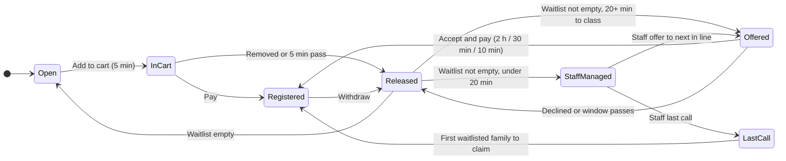

<div align="center">

# 🌲 Cedar Valley Parks & Recreation

### Program registration that never overbooks and never lets a freed seat sit idle

Families browse seasonal programs, hold a spot while they check out, and join a fair waitlist. Each freed seat
goes to the next family in line, with less time to accept as the class gets closer.


[Priorities](#-priorities) ·
[Core requirements](#-core-requirements) ·
[Constraints](#-constraints) ·
[Stakeholder requests](#-stakeholder-requests) ·
[Tradeoffs](#%EF%B8%8F-tradeoffs) ·
[Agentic development](#-agentic-development) ·
[Phase 2](#-phase-2) ·
[Run it](#-run-it-locally)

</div>

> [!NOTE]
> **Payments and notifications are simulated.** No card is ever charged and no text or email is sent. "Charging"
> records a paid registration, and texts and emails are written to an outbox table and printed to the server log.
> See [What's real and what's simulated](#-whats-real-and-whats-simulated).

---

## 🎯 Priorities

| Priority | Change | Status | Where |
|---|---|---|---|
| **P0** | Concurrency and overbooking prevention | ✅ Section row locks on every change, plus a database trigger that rejects any commit over capacity | `booking.ts`, `004_…sql` |
| **P0** | Dynamic waitlist expiration | ✅ Offer windows of 2 h, 30 min or 10 min depending on time until the first class. Staff take over in the last 20 minutes | `offerWindowMs`, `autoOfferExpiry` |
| **P0** | Fix expired-offer transaction bug | ✅ Reproduced with a failing test, then fixed. A request that fails a check no longer undoes the expirations it processed | `bookingTx`, `settleSection` |
| **P0** | Waitlist fairness | ✅ Strict first-come-first-served offers. While anyone is waiting, an open seat can't be grabbed by someone who isn't on the waitlist | `promoteWaitlist`, `addToCart` |
| **P1** | Last-minute waitlist optimization | ✅ Staff "last call": every waitlisted family is notified, and the first to claim gets the seat. Only once automatic offers have stopped | `staffLastCall`, `claimSpot` |
| **P1** | Waitlist audit trail | ✅ Every join, leave, offer, accept, decline, expiry, last call and claim, recorded in the same transaction as the change | `waitlist_events`, staff page |
| **P1** | Clarify simulated payments and notifications | ✅ Called out in the app, on the staff page and [below](#-whats-real-and-whats-simulated) | |
| **P1** | README and agentic development | ✅ This file, including the [independent AI review](#independent-ai-review) | |

## ✅ Core requirements

| # | Requirement | How it's met | Proof |
|---|---|---|---|
| 1 | **Implement the registration design** in React + TypeScript, using the codebase's own components | Shared tokens (`client/src/styles/tokens.css`) and components (`Button`, `Chip`, `Card`, `CapacityDots`, `OfferBanner`, …) cover browse, program detail, checkout, confirmation and My registrations | Walked through in a browser at desktop and phone widths |
| 2 | **Postgres backend** | Express + `pg` API with SQL migrations in `server/migrations/` | Migrations apply automatically on start |
| 3 | **Never exceed capacity**, even with simultaneous registrations, cancellations and waitlist acceptances | Every change locks the section row and recounts seats before writing. A deferred constraint trigger re-checks at commit as a backstop | 25 families racing for the last seat: exactly 1 succeeds. Cancellations, walk-ins and acceptances all at once never overbook |
| 4 | **Free up seats when waitlist time ends** | Offers carry an `expires_at`. Every write and a 1-second sweeper release expired offers and pass the seat to the next family | Offers pass down the line with windows recomputed for the new time |
| 5 | **Offer windows tied to class start** (`sections.starts_at`) | See the table below. No automatic offer is made, or still open, in the last 10 minutes; staff can override | Tests for each band and both boundaries |

## 📏 Constraints

### Waitlist offer windows

| Time until the first class | Time to accept an offer |
|---|---|
| More than 24 hours | **2 hours** |
| 2–24 hours | **30 minutes** |
| 20 minutes–2 hours | **10 minutes** |
| Under 20 minutes | **Staff-managed**: no automatic offer |

The window is fixed when the offer is made. If it lapses, the next family's window is worked out again from the new
time, so offers speed up as class approaches. Automatic offers stop 10 minutes before class: the 10-minute offers
made at 20 minutes out end exactly then, and `autoOfferExpiry` never lets an automatic offer run past that cutoff.

### Other rules

| Rule | Value | Where |
|---|---|---|
| Cart hold | **5 minutes**, then the seat is released | `HOLD_MS` |
| Seats one family can hold at once | **3** | `CART_MAX` |
| Sections per program a child can be in | **1** (registered, held or waitlisted) | `assertChildFree` |
| Waitlist priority | While anyone is waiting, an open seat goes to the waitlist, never to a new cart | `addToCart` |
| Class size | Set per program, with the reason shown to families (e.g. "1 instructor per 6 swimmers") | `sections.capacity`, `programs.capacity_note` |
| Registration opening time | Nothing can be carted or waitlisted before it | `programs.registration_opens_at` |
| Charging waitlisted families | **Only when they accept** (or claim during a last call). Never automatically | `acceptOffer`, `claimSpot` |
| Privacy between families | Nobody sees that another family is holding or being offered a seat, or for how long | `getState` |
| The design keeps evolving | Colors live in tokens and UI in shared components, so design updates mostly touch those | `client/src/styles/tokens.css` |

## 🗣️ Stakeholder requests

### Implemented

| Request | What changed |
|---|---|
| **`starts_at` on sections** | Each section stores its first class as a real timestamp (`004_…sql`); the day and time labels stay as display copy. The program page shows "First class Mon, Jan 4, 4:00 PM". |
| **Offer windows based on class start** | Windows shrink from 2 hours to 30 and then 10 minutes as the first class approaches. Notices and texts state the actual window, e.g. "You have 10 minutes to accept it". |
| **Move to the next family when an offer expires** | Already handled by every write and the sweeper. The rollback bug below sometimes delayed it until the next sweep; now it happens in the same request. |
| **Stop automatic offers 10 minutes before class, with staff override** | Under 20 minutes there are no automatic offers, and none can run past the 10-minute mark. The staff page (`/staff`) lets staff offer a seat to the next family with a window they choose, at any time, or run a last call. |
| **Charge only when a waitlist offer is accepted** | Accepting registers the child and charges the saved card in one step. An offer that's declined or left to expire costs nothing. The button reads **Accept and pay $85** so the charge is clear. |
| **Don't show other families eyeing a seat** | The API sends other families' holds only as a "taken" count, with no timers, so they can't be found by inspecting the page either. |
| **Remove "Register and charge me automatically"** | Removed from the code and from the design (see below). |
| **Class sizes, opening times and reminders, policy placeholder** (design updates) | "Up to N kids per class" with the reason; "Notify me when it opens"; *Cancellation and refund policy: [TO BE CONFIRMED]*. |

### Pushed back

> [!IMPORTANT]
> **"Register and charge me automatically" waitlist mode** (added in the second design iteration)
>
> In this mode, a waitlisted family was registered and charged the moment a seat opened, without accepting. That broke the
> core requirement that **nobody is charged unless they accept their offer in time**. We flagged the conflict, removed the
> mode from the code (`003_charge_on_accept.sql` drops its columns), and removed it from the design so later design updates
> don't bring it back.

## ⚖️ Tradeoffs

| Decision | Why | Cost |
|---|---|---|
| **Strict first-come-first-served offers by default** | Fair and predictable. Families keep their place in line | A seat can stay empty while one family sits on an offer. Shrinking windows near class time limit this |
| **Last call is a staff decision, not automatic** | Notifying everyone at once fills seats faster but gives up line order, so a person decides when that's worth it | Needs staff attention in the last 20 minutes. Making it automatic is a one-line policy change if wanted |
| **Open seats are kept for the waitlist** | Someone who wasn't waiting can't take a seat from families who were | If staff don't act in the last 20 minutes, the seat may go unused |
| **Reading "<20 min staff-managed" with "stop 10 min before"** | The table says automatic offers end at 20 minutes; the 10-minute rule then works as a hard cap: no automatic offer can still be open inside the last 10 minutes | Staff overrides are exempt, by design |
| **Row lock per section, not optimistic retries** | Simple to reason about; requests queue rather than fail and retry | Very hot sections serialize. Fine at a city rec department's scale |
| **Database capacity trigger as a backstop** | Even a future bug in the API can't commit an overbooked section | One extra count per write |
| **Sweeper revisits every waitlisted section each second** | A seat is offered as soon as the rules allow it, even if no request touches the section | More lock traffic. `SKIP LOCKED` keeps it out of the way of real requests |
| **`starts_at` is the first class only** | Offer windows only matter before a session starts | Late registration for classes already under way isn't modeled |
| **Polling every 2 seconds** | Simple, and good enough to show countdowns | A seat can appear open for up to 2 seconds after it's taken (it can't be double-booked) |

## 🧾 What's real and what's simulated

| | Real | Simulated |
|---|---|---|
| **Seats, holds, waitlist, offers** | ✅ All in Postgres, enforced under locks | |
| **Payments** | Registration is only created on accept, claim or checkout | No card is charged. "Saved card ending 4242 (demo)". The hook for a real charge is in `registerFromWaitlist` and `checkout` |
| **Texts and emails** | Every notice is queued in `notifications` with `send_sms` / `send_email` flags | Nothing is sent. `server/src/outbox.ts` prints each one to the server log and marks it delivered |
| **Sign-in** | | Families are identified by an `X-Family-Id` header (default: the demo family). Staff routes use a shared `STAFF_TOKEN`, open in dev when it's unset |
| **Other families** | | Seeded enrollments and the prototype controls stand in for other families |

## 🤖 Agentic development

This project was built with Claude Code, from the design artifact to the database. How the work was checked:

- **Tests first for bugs.** The expired-offer bug and every confirmed review finding were reproduced with a failing test before being fixed, and those tests stay in the suite.
- **Real database in tests.** Concurrency claims are tested by firing requests in parallel at Postgres, not with mocks.
- **Browser checks.** Each flow was clicked through with Playwright at desktop and phone widths.
- **Independent AI review.** A separate agent with no shared context reviewed the booking code against the business rules.

### Bugs found and corrections

| # | Found by | Problem | Correction |
|---|---|---|---|
| 1 | Stakeholder priority, then a failing test | **Expired-offer transaction bug.** A request that released an expired offer and passed the seat to the next family, then failed its own check, rolled all of it back. The seat sat idle until the sweeper's next pass | `settleSection` now ends with `SAVEPOINT settled`, and `bookingTx` rolls back only to there on a booking error. Regression tests cover accept-after-expiry and a failed add-to-cart |
| 2 | Requirement review | **Auto-charge waitlist mode** in the design charged families without accepting | Pushed back and removed from code and design |
| 3 | Stakeholder correction | **Privacy leak.** The API sent other families' hold timers, and the page showed "Someone has the last spot… 2:29" | Other families' holds are folded into a `taken` count server-side |
| 4 | Writing the dynamic-window tests | **Open seat with a waitlist could be carted by a walk-in** once automatic offers stopped near class time | Waitlist priority check in `addToCart`; joining the waitlist is allowed while a seat is reserved for it |
| 5 | Flaky test runs | Tests compared times read from the clock twice, a few milliseconds apart | Tests capture one timestamp per step |
| 6 | Independent AI review | **Deadlocks, a poisoned pooled connection, and a fragile sweeper**, plus four smaller issues | See [below](#independent-ai-review) |
| 7 | Browser check | The notification toast covers the offer banner's *Accept and pay* button until dismissed (also in the design) | Open: listed in Phase 2 |

### Independent AI review

After the features above were built and tested, a separate Claude agent with fresh context reviewed the booking code
read-only against the business rules. It could run the test suite and probe a scratch database, but not change the repo.
Every confirmed finding was reproduced as a failing test here before it was fixed.

**What it confirmed was sound:** no way to overbook, skip the line, or see another family's holds; the savepoint fix
is correct (including checkouts that settle several sections); offer-window boundaries match the spec.

| Finding | Severity | Correction |
|---|---|---|
| **Deadlocks despite the documented lock order.** Inserting an offer or notice for family F takes a key-share lock on F's row, which `FOR UPDATE` blocks. So a request holding a section could wait on F while F's own request (holding F) waited on the section. Reproduced: two siblings on one waitlist, one accepting while a withdrawal promoted the other → `deadlock detected`, and the family saw an error | High | Family and child rows are locked `FOR NO KEY UPDATE`, which still serializes their requests but doesn't block key-share locks. `bookingTx` also retries a deadlock or serialization failure up to 3 times as a safety net |
| **A lookup for an unknown family left a read-only transaction open** on a pooled connection, so the next booking request to get it failed (`cannot execute SELECT FOR UPDATE in a read-only transaction`). Any request with a bad `X-Family-Id` could trigger it | Medium-High | `getState` rolls back before returning |
| **One failing section aborted the whole sweeper pass**, delaying every other section's expirations and the opening reminders | Medium | Each section is swept in its own try/catch, with a 2-second lock timeout so the sweeper never queues behind a request for long |
| Offers weren't re-capped when a class was moved earlier | Low | Moving a start time pulls open offers inside the new 10-minute cutoff |
| A connection whose rollback failed went back to the pool | Low | It's discarded instead |
| A failed commit while keeping settled work was silent | Low | Logged |
| Notices said an expired offer "went to the next family", which isn't true under 20 minutes | Low | Reworded |

**Accepted as-is:** the request time is read before waiting for locks, so a queued request uses a slightly stale time
(no capacity effect). With dev tools on and no `STAFF_TOKEN`, the staff view is open to anyone, so set the token anywhere
real families' data exists.

## 🚀 Phase 2

| Area | What it would take |
|---|---|
| 💳 **Real payments** | Connect a provider that supports charging a saved card on accept. A declined card throws, rolling the acceptance back (hooks in `registerFromWaitlist` and `checkout`). |
| 📱 **Text and email delivery** | Connect an SMS and email provider in `server/src/outbox.ts`. The queue already exists. |
| 🔐 **Sign-in** | Real family accounts, and staff accounts with roles instead of the shared `STAFF_TOKEN`. |
| ⏱️ **Automatic last call** | If staff want it, start a last call automatically at 20 minutes out instead of waiting for a click. |
| ⚡ **Live updates** | Server-sent events instead of 2-second polling. |
| 🏁 **One-click waitlist after losing the last seat** | Put *Join the waitlist* in the "just filled up" message. |
| 🔔 **Notification fixes** | Queue toasts so two notices arriving together are both shown, and keep the toast off the *Accept and pay* button. |
| 🧾 **Cancellation and refunds** | Replace the *[TO BE CONFIRMED]* placeholder with the real policy and build refunds on withdraw. |
| 🛠️ **More staff tools** | Set class sizes, start times, opening times and seasons; rosters; export the audit trail. |
| 🎨 **Design sync** | The design still moves accepted offers through the cart, shows other families' holds, and has no staff page or shrinking windows. |

---

## 🔍 How it works

### The life of a seat



Each freed seat goes to **one** family at a time, the first in line. Everyone else keeps their place and isn't contacted.
Because the offer reserves the seat, two families can never both accept it.

### When several families click the last seat at once

1. Each request locks the section's row in Postgres, so requests run one at a time, roughly in arrival order. This holds across several API servers.
2. Inside the lock, expired holds are released (to the waitlist first) and open seats are recounted.
3. The first request gets the seat and a 5-minute hold. The rest are told **"That section just filled up. You can join the waitlist."** Nothing is written for them.
4. At checkout the server re-checks the holds under the lock, so nobody pays for a seat they lost.
5. At commit, a database trigger re-counts the section and rejects the transaction if it would be over capacity.

Locks are always taken in the same order (family, then child, then section), so requests can't deadlock.

### Data model

| Table | Holds |
|---|---|
| `programs`, `sections` | Catalog, class size, `starts_at`, opening time, staff `last_call_until` |
| `registrations` | Confirmed seats (`from_waitlist` marks accepted offers and claims) |
| `holds` | Temporary reservations: `cart` (5 min) or `offer` (window depends on class start) |
| `waitlist_entries` | The line, ordered by id |
| `waitlist_events` | Audit trail: who, what, when, by whom (family, system or staff) |
| `notifications` | In-app notices, and the outbox for texts and emails |
| `registration_reminders` | "Notify me when it opens" requests |

---

## 🧑‍💻 Run it locally

You need Node 20+ and Postgres 16. If you don't have Postgres, `docker compose up -d` starts one.

```bash
cp .env.example .env
```

```bash
npm install
```

```bash
npm run db:seed
```

```bash
npm run dev
```

Open http://localhost:5173 for the family site and http://localhost:5173/staff for the staff view. The API runs on :4000, and Vite
proxies `/api` to it.

### Tests

Tests run against a real Postgres in a separate database (`parks_test` by default; override with `TEST_DATABASE_URL`).

```bash
createdb -U parks parks_test
```

```bash
npm test
```

<details>
<summary><b>What the 38 tests cover</b></summary>

**Concurrent booking and capacity**
- Many families racing for the last seat: exactly one gets it
- A busy section never goes over capacity with mixed adds, removes and checkouts
- Cancellations, walk-ins and waitlist acceptances all at once never overbook or skip the line
- The database refuses any write that would put a section over capacity
- One child can't be booked into two sections of a program at once
- A family can hold at most 3 seats, even when requests arrive together
- Families joining a waitlist at once get distinct places in line

**Holds, offers and charging**
- An expired cart hold frees the seat when nobody is waiting
- A freed seat is offered down the waitlist, and opens to everyone when the line runs out
- Accepting an offer registers the child and charges in one step
- An offer can't be accepted after it expires
- Checkout refuses when the cart changed under the family
- Nobody on the waitlist is registered or charged without accepting, even as offers lapse

**Dynamic offer windows**
- Windows of 2 hours, 30 minutes and 10 minutes for each band, and at the 20-minute boundary
- Under 20 minutes nothing is offered automatically, and the seat stays with the waitlist
- An expired offer moves to the next family with a window recomputed for the new time
- Unit tests for every band boundary, the 10-minute cutoff and duration wording

**Staff overrides and the audit trail**
- Staff can offer the seat to the next family, even inside the last 10 minutes
- Last call: everyone waiting is told, and of simultaneous claims exactly one wins
- Last call is refused while automatic offers are still running
- The audit trail records joins, offers, declines, expirations and acceptances in order

**Regressions for bugs found**
- Accepting an expired offer still passes the seat on, without waiting for the sweeper
- A request that fails a check still keeps the expirations it processed
- Two siblings on one waitlist: an accept and a withdrawal at once don't deadlock
- A family's own lock never blocks the sweeper from offering that family a seat
- Asking for an unknown family leaves no open transaction on a pooled connection
- A checkout across two sections keeps both waitlist promotions when it fails
- Moving a class earlier pulls open offers back inside the 10-minute cutoff

**Opening times, privacy and the API**
- Nobody can cart or waitlist before registration opens, and reminders go out when it does
- Another family's cart hold and waitlist offer show only as taken seats, with no timers
- Accepting an offer over HTTP returns the paid registration
- Add to cart, and the error shape for a full section

</details>

### Prototype controls

With `ENABLE_DEV_TOOLS=true`, the API exposes `/api/dev/*` and the site shows the design's prototype panel. It lets you:
- skip the clock ahead
- simulate another family dropping out or carting a seat
- move *Swim 2 · Saturdays* to start in 25 h, 3 h, 1 h or 15 min, to see offer windows shrink and staff take over
- open the staff view
- reset the demo

**Keep this off in production.**

### Project layout

```
client/   React + TypeScript (Vite): screens (including /staff), components, design tokens
server/   Express API, booking rules (src/booking.ts), staff view (src/staff.ts), migrations, tests
shared/   Types, booking constants and the offer-window rules used by both
```
