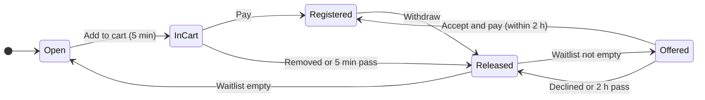

<div align="center">

# 🌲 Cedar Valley Parks & Recreation

### Program registration that never double-books a spot

Families browse seasonal programs, hold a spot while they check out, and join a fair waitlist that
offers each freed spot to the next family in line.


[Core requirements](#-core-requirements) ·
[Constraints](#-constraints) ·
[Stakeholder requests](#-stakeholder-requests) ·
[Phase 2](#-phase-2) ·
[How it works](#-how-it-works) ·
[Run it](#-run-it-locally)

</div>

---

## ✅ Core requirements

| # | Requirement | How it's met | Proof |
|---|---|---|---|
| 1 | **Implement the registration design** in React + TypeScript, using the codebase's own components | Shared tokens (`client/src/styles/tokens.css`) and components (`Button`, `Chip`, `Card`, `CapacityDots`, `OfferBanner`, …) cover browse, program detail, checkout, confirmation and My registrations | Walked through in a browser at desktop and phone widths |
| 2 | **Postgres backend** | Express + `pg` API with SQL migrations in `server/migrations/` | Migrations apply automatically on start |
| 3 | **Handle many booking requests at the same time** | Every change locks the section row (`SELECT … FOR UPDATE`) and recounts open spots before writing, so a section can't be oversold | 25 families racing for the last spot: exactly 1 succeeds |
| 4 | **Track slots so they free up when waitlist time ends** | Holds carry an `expires_at`. A sweeper and every write release expired holds and offer the spot to the next family | Offers pass down the line as each one lapses; the spot opens to all once the line is empty |

## 📏 Constraints

| Rule | Value | Where |
|---|---|---|
| Cart hold | **5 minutes**, then the spot is released | `HOLD_MS` |
| Waitlist offer | **2 hours** to accept, then it goes to the next family | `OFFER_MS` |
| Spots one family can hold at once | **3** | `CART_MAX` |
| Sections per program a child can be in | **1** (registered, held or waitlisted) | `assertChildFree` |
| Class size | Set per program, with the reason shown to families (e.g. "1 instructor per 6 swimmers") | `sections.capacity`, `programs.capacity_note` |
| Registration opening time | Nothing can be carted or waitlisted before it | `programs.registration_opens_at` |
| Charging waitlisted families | **Only when they accept**, within the 2 hours. Never automatically | `acceptOffer` |
| Privacy between families | Nobody sees that another family is holding or being offered a spot, or for how long | `getState` |
| The design keeps evolving | Colors live in tokens and UI in shared components, so design updates mostly touch those | `client/src/styles/tokens.css` |

## 🗣️ Stakeholder requests

### Implemented

| Request | What changed |
|---|---|
| **Charge only when a waitlist offer is accepted** | Accepting registers the child and charges the saved card in one step, with no separate checkout. An offer that's declined or left to expire costs nothing. The button reads **Accept and pay $85** so the charge is clear. |
| **Don't show other families eyeing a spot** | Removed the "Someone has the last spot in their cart… 2:29" messages and the orange *Held for another family* dots. The API no longer sends other families' holds or timers, so they can't be found by inspecting the page either. |
| **Remove "Register and charge me automatically"** | Removed from the code and from the design (see below). |
| **Class sizes per program** (design update) | Cards show "Up to N kids per class". The program page explains why, and the capacity dots resize for larger classes. |
| **Registration opening times and reminders** (design update) | Programs show when they open. Families can ask to be texted and emailed when registration opens. |
| **Cancellation policy placeholder** (design update) | The footer and checkout show *Cancellation and refund policy: [TO BE CONFIRMED]* until the policy is decided. |

### Pushed back

> [!IMPORTANT]
> **"Register and charge me automatically" waitlist mode** (added in the second design iteration)
>
> In this mode, a waitlisted family was registered and charged the moment a spot opened, without accepting. That broke the
> core requirement that **nobody is charged unless they accept within 2 hours**. We flagged the conflict, removed the mode from the
> code (`003_charge_on_accept.sql` drops its columns), and removed it from the design so later design updates don't bring it back.

## 🚀 Phase 2

| Area | What it would take |
|---|---|
| 💳 **Real payments** | Connect a payment provider that supports charging a saved card on accept. A declined card rolls back the registration (the hook is in `acceptOffer` and `checkout`). |
| 📱 **Text and email delivery** | Notices are already queued in `notifications`. Connect an SMS and email provider in `server/src/outbox.ts`. |
| 🔐 **Sign-in** | Replace the `X-Family-Id` header (`familyOf` in `server/src/app.ts`) with real accounts and family profiles. |
| ⚡ **Live updates** | Swap the 2-second polling for server-sent events, so families see a spot fill instantly instead of up to 2 seconds late. |
| 🔁 **Faster waitlists** | Decide how fast a freed spot should move: keep the strict queue, shorten the 2-hour window (e.g. 30 minutes), or offer it to everyone at once and give it to whoever accepts first. |
| 🏁 **One-click waitlist after losing the last spot** | When a family is told "That section just filled up", add a *Join the waitlist* button right there, so they don't lose their place to someone who clicked later. |
| 🔔 **Notification fixes** | Queue toasts so two notices arriving together are both shown, and keep the toast from covering the offer banner's *Accept and pay* button. |
| 🧾 **Cancellation and refunds** | Replace the *[TO BE CONFIRMED]* placeholder with the real policy and build refunds on withdraw. |
| 🛠️ **Staff tools** | Screens for staff to set class sizes, opening times and seasons, and to see rosters and waitlists. |
| 🎨 **Design sync** | The design still moves accepted offers through the cart and shows other families' holds. Update it to match the two changes above. |

---

## 🔍 How it works

### The life of a spot



Each freed spot goes to **one** family at a time, the first in line. Everyone else keeps their place and isn't
contacted. Because the offer reserves the spot, two families can never both accept it.

### When several families click the last spot at once

1. Each request locks the section's row in Postgres, so requests run one at a time, roughly in arrival order. This holds across several API servers.
2. Inside the lock, expired holds are released (to the waitlist first) and open spots are recounted.
3. The first request gets the spot and a 5-minute hold. The rest are told **"That section just filled up. You can join the waitlist."** Nothing is written for them.
4. At checkout the server re-checks the holds under the lock, so nobody pays for a spot they lost.

Locks are always taken in the same order (family, then child, then section), so requests can't deadlock.

### Data model

| Table | Holds |
|---|---|
| `programs`, `sections` | Catalog, class size, opening time |
| `registrations` | Confirmed spots (`from_waitlist` marks accepted offers) |
| `holds` | Temporary reservations: `cart` (5 min) or `offer` (2 h) |
| `waitlist_entries` | The line, ordered by id |
| `notifications` | In-app notices, and the outbox for texts and emails |
| `registration_reminders` | "Notify me when it opens" requests |

---

## 🧑‍💻 Run it locally

You need Node 20+ and Postgres 16. If you don't have Postgres, `docker compose up -d` starts one.

```bash
cp .env.example .env
```

```bash
npm install
```

```bash
npm run db:seed
```

```bash
npm run dev
```

Open http://localhost:5173. The API runs on :4000, and Vite proxies `/api` to it.

### Tests

Tests run against a real Postgres in a separate database (`parks_test` by default; override with `TEST_DATABASE_URL`).

```bash
createdb -U parks parks_test
```

```bash
npm test
```

<details>
<summary><b>What the 15 tests cover</b></summary>

**Concurrent booking**
- Many families racing for the last spot: exactly one gets it
- A busy section never goes over capacity with mixed adds, removes and checkouts
- One child can't be booked into two sections of a program at once
- A family can hold at most 3 spots, even when requests arrive together
- Families joining a waitlist at once get distinct places in line

**Holds and the waitlist**
- An expired cart hold frees the spot when nobody is waiting
- A freed spot is offered down the waitlist, and opens to everyone when the line runs out
- Accepting an offer registers the child and charges in one step
- An offer can't be accepted after it expires
- Checkout refuses when the cart changed under the family
- Nobody on the waitlist is registered or charged without accepting, even as offers lapse

**Opening times, privacy and the API**
- Nobody can cart or waitlist before registration opens, and reminders go out when it does
- Another family's hold shows only as a taken spot, with no timer
- Accepting an offer over HTTP returns the paid registration
- Add to cart, and the error shape for a full section

</details>

### Prototype controls

With `ENABLE_DEV_TOOLS=true`, the API exposes `/api/dev/*` and the site shows the design's prototype panel. It lets you skip the
clock ahead, simulate another family dropping out or carting a spot, and reset the demo. **Keep this off in production.**

### Project layout

```
client/   React + TypeScript (Vite): screens, components, design tokens
server/   Express API, booking rules (src/booking.ts), migrations, tests
shared/   Types and booking constants used by both
```
